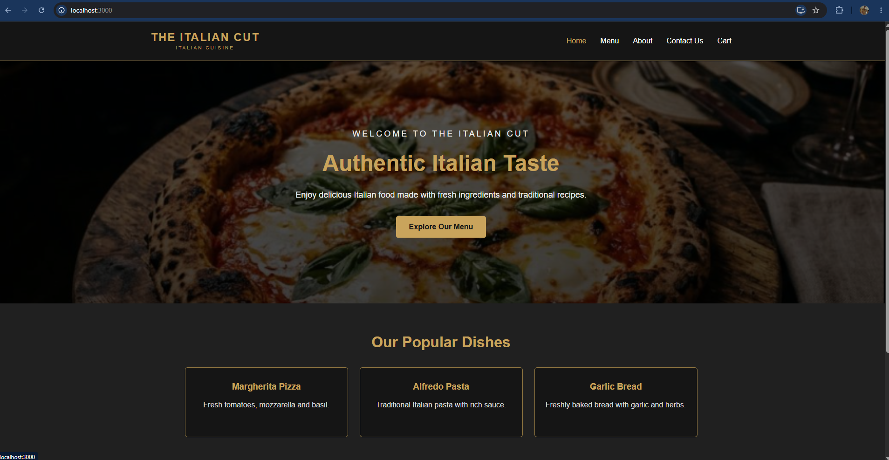
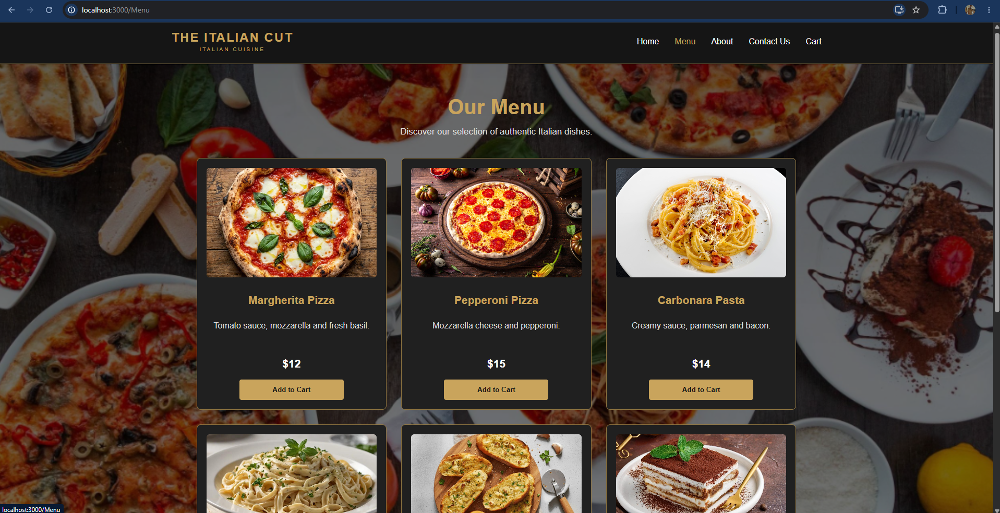
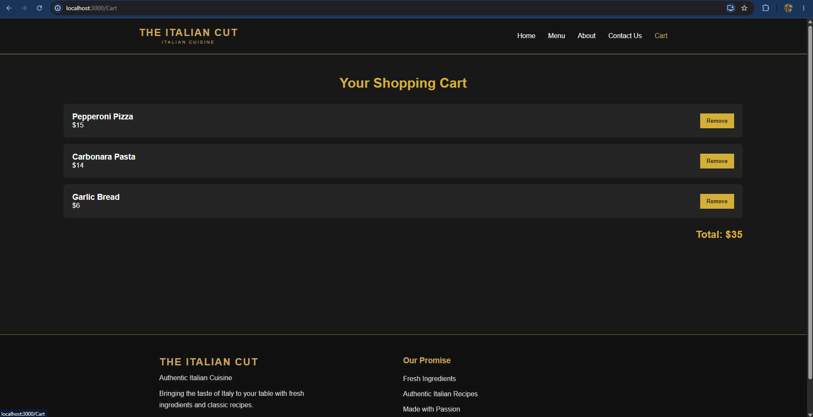
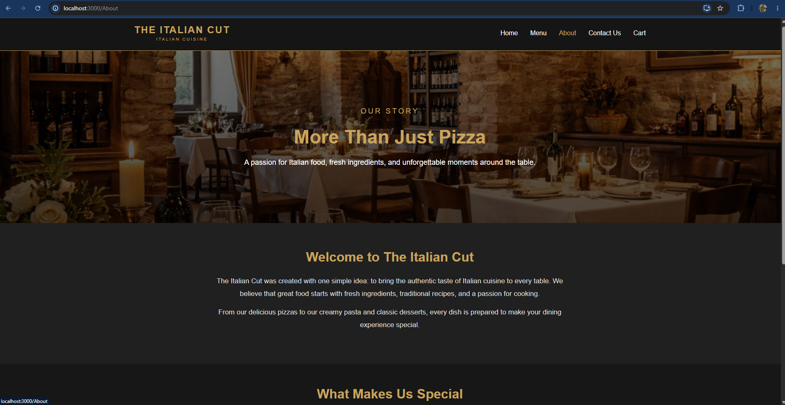
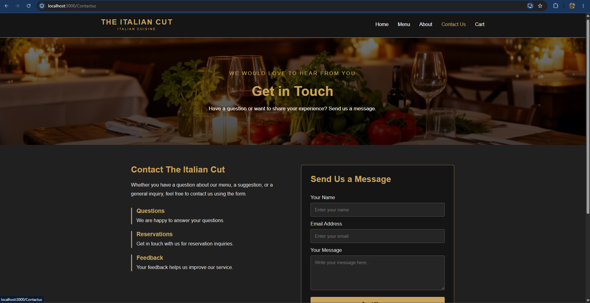

# The Italian Cut

## Project Description

The Italian Cut is a restaurant website developed using React.js. The website allows visitors to explore an Italian restaurant, view its food menu, add food items to a shopping cart, and calculate the total price of their selected items.

The project features a modern black-and-gold design inspired by Italian restaurants. It includes five main pages: Home, Menu, About, Contact Us, and Cart.

## Technologies Used

- React.js
- JavaScript
- HTML
- CSS
- React Router DOM

## Setup Instructions

Follow these steps to run the project locally:

1. Clone the repository:

   git clone YOUR_GITHUB_REPOSITORY_URL

2. Navigate to the project directory:

   cd the-italian-cut

3. Install the required dependencies:

   npm install

4. Start the React development server:

   npm start

## Screenshots of the UI

The following screenshots demonstrate the main pages and features of The Italian Cut website.

### 1. Home Page

### 2. Menu Page

### 3. Shopping Cart

### 4. About 

### 5. Contact Us

## Project Author

Nail Nasr

## Course

CSCI426 – Advanced Web Programming